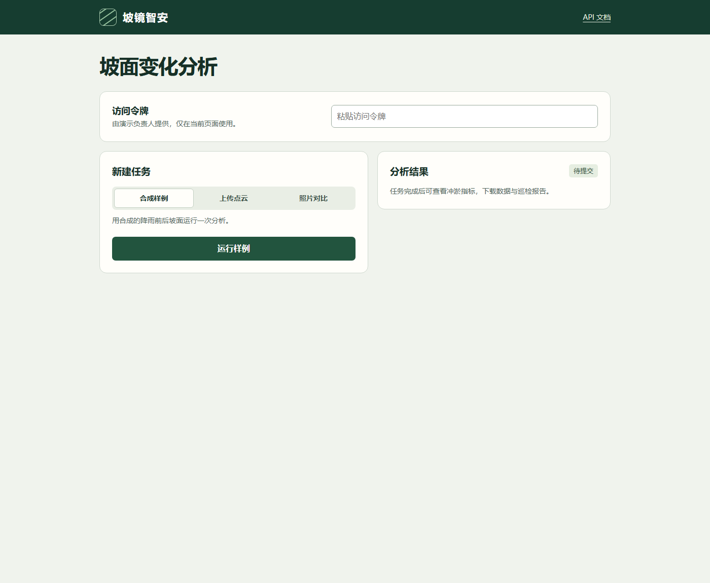
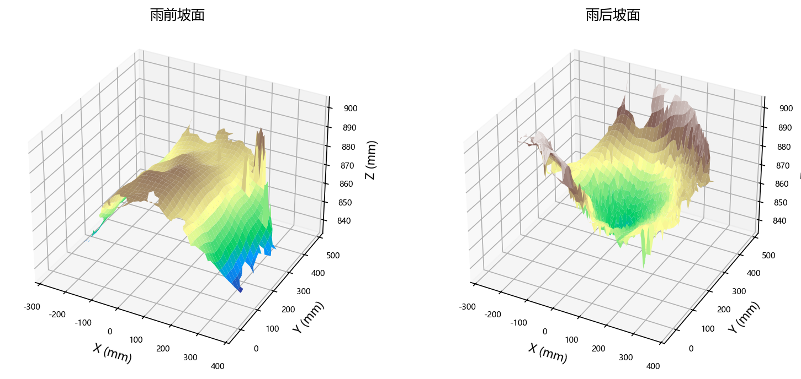
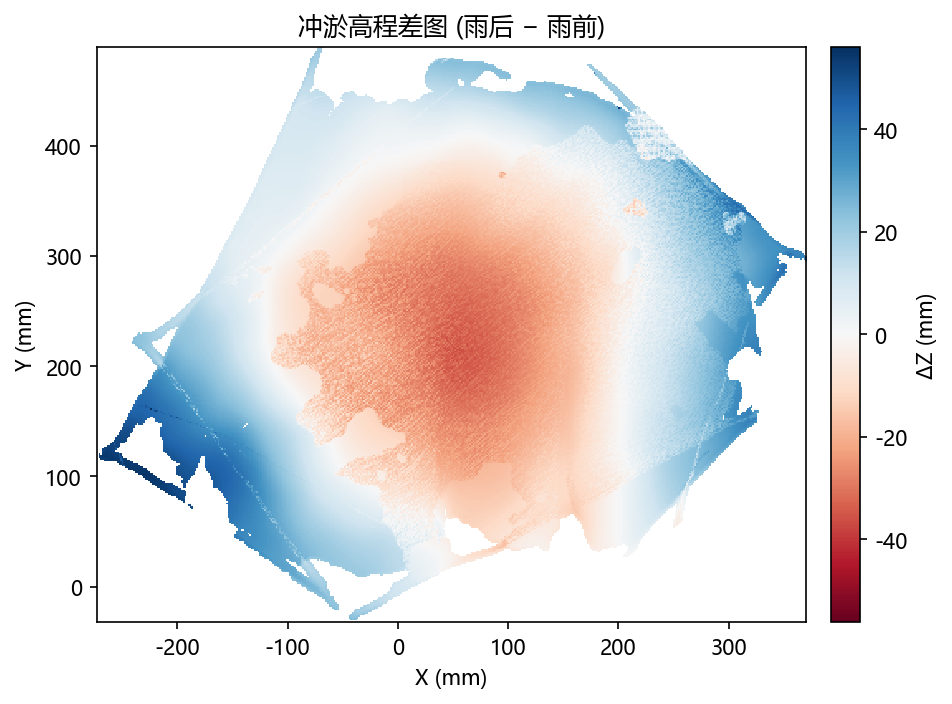
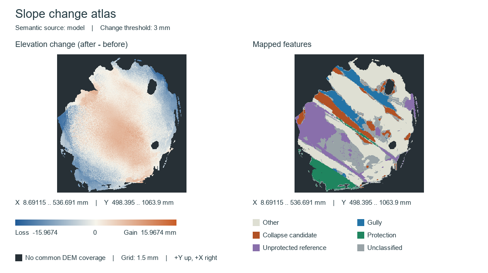
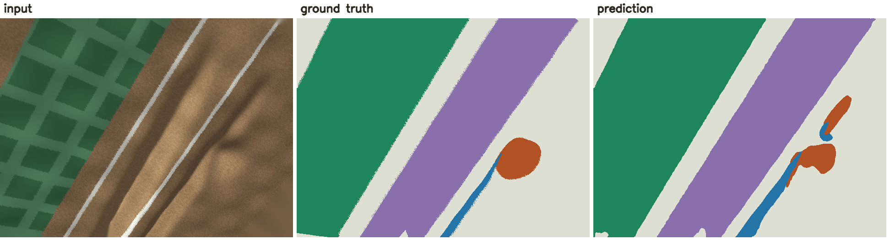

# 坡镜智安 SlopeWatch · 边坡视觉监测原型

> 多视角照片 → VGGT 三维重建 → 两期配准 → 冲淤量化 + 语义图谱 → 巡检报告
> 31 个自动化测试通过 · 文档版本 v1.0



## 文档导航

| 文档 | 内容 | 适合谁看 |
|---|---|---|
| [README](README.md) | 安装、启动、接口、参数 | 所有人 |
| [项目现状与计划](<docs/SlopeWatch_项目现状与计划.docx>) · [Markdown](docs/PROJECT_STATUS.md) | 端到端流程、完成度、P0/P1/P2、风险、运行手册 | 队友 / 指导老师 |
| [技术选型与框架清单](<docs/SlopeWatch_技术选型与框架清单.docx>) · [Markdown](docs/TECH_STACK.md) | 每个模块的框架、模型、版本、理由与替代 | 答辩 / 评审 |
| [标注与微调指南](docs/annotation_guide.md) | 类别定义、画笔工具、微调、验收 | 做数据的人 |
| [自监督与公开数据集](docs/WEAK_SUPERVISION.md) | 规则阈值、自训练、3 个 CC-BY 数据集 | 算法 / 数据 |
| [演示手册](<docs/SlopeWatch_演示手册.docx>) · [指南](docs/DEMO_GUIDE.md) | 5 分钟分镜、60 秒电梯版、故障兜底、必答题 | 答辩 / 演示 |
| [示例报告](docs/example_report.pdf) | 一次任务的 PDF 产出 | 评委 |

## 仓库结构

```text
slopewatch/          核心库：重建、配准、量化、语义、报告
api.py public_api.py 本机接口 / 带令牌的公网入口
jobs.py              任务编排
web/index.html       远程页面（原生 JS）
app.py               Streamlit 桌面演示
scripts/             标注、训练、合成数据、发布脚本
models/              五类分割 ONNX / PyTorch 权重
tests/               31 个自动化测试
docs/                文档、示例图、示例 PDF
data/                运行数据（本地，未入库）
```

## 快速开始（照片对比）

```powershell
python -m pip install -r requirements.txt
python scripts/run_demo.py --mode quick        # 2 秒离线演示（不需要 GPU/网络）
# VGGT 代码与权重（只需一次）
git clone https://github.com/facebookresearch/vggt.git
python -m pip install -e .\vggt
# 权重放到 D:\models\VGGT-1B\model.safetensors，或用环境变量指定
$env:SLOPEWATCH_VGGT_CHECKPOINT = "D:\models\VGGT-1B\model.safetensors"

uvicorn api:app --host 127.0.0.1 --port 8001
streamlit run app.py --server.address 127.0.0.1
```

浏览器打开 `http://127.0.0.1:8501`，选择“照片对比（VGGT）”，分别上传雨前、雨后两个照片 ZIP 即可。远程演示入口使用 `public_api:app`（Bearer 令牌），见下文“校赛远程演示”。

## 校赛远程演示

GitHub 保存源码（[Zzz123bit/slopewatch](https://github.com/Zzz123bit/slopewatch)）。比赛电脑运行 FastAPI 并保存任务结果。评委在手机或电脑上打开 HTTPS 地址，输入团队令牌，就能提交合成样例或两期点云、查看冲淤指标并下载巡检报告。远程页面与 API 共用一个域名。

```text
评委浏览器或调用程序 → Cloudflare HTTPS 地址 → Cloudflare Tunnel
                                                ↓
                      比赛电脑 127.0.0.1:8011 → 分析任务和报告
```

### 启动临时演示

在 Windows 比赛电脑上准备 Python 和 cloudflared。首次使用先安装下方“启动”中的 Python 依赖。安装 cloudflared 的命令为 `winget install --id Cloudflare.cloudflared --exact`，也可使用 Cloudflare 官方的 Windows 发行包。[cloudflared 下载](https://developers.cloudflare.com/cloudflare-one/networks/connectors/cloudflare-tunnel/downloads/)

在项目根目录执行以下两条命令。第一条将本机的演示令牌复制到剪贴板，可单独发给评委。第二条启动服务并显示 `https://….trycloudflare.com`。保持比赛电脑联网、唤醒，保留该终端；按 Ctrl+C 结束。每次重新启动临时隧道都可能获得新地址。

```powershell
.\scripts\copy-demo-token.ps1
.\scripts\start-public.ps1
```

浏览器打开终端给出的地址，粘贴令牌并点击“运行样例”。切换到“上传点云”可以提交自己的数据。手机关闭 Wi-Fi、用移动网络尝试下载巡检 PDF，可以检验比赛现场的外网访问。网络中断后，页面提供对当前任务重新查询的按钮。批量照片可在 `/docs` 上传 ZIP，依赖比赛电脑配置的 COLMAP。

公网启动脚本使用单独的应用 `public_api:app`。本机开发入口 8001 和 Streamlit 8501 可继续使用。隧道的源地址固定为 `http://127.0.0.1:8011`。已有令牌可通过进程环境变量 `SLOPEWATCH_API_TOKEN` 传入（至少 32 位，由英文字母、数字、下划线、连字符组成）。所有持有团队令牌的人属于同一演示团队，能查询已知任务 ID 的结果。演示用的共享凭据适合邀请制校赛。

### 调用接口

远程公共入口 `GET /livez` 返回服务标识，`/docs` 可使用 **Authorize** 试调。所有 `/api/v1/` 请求，包括下载，均发送 `Authorization: Bearer <团队令牌>`。下表中的路径都相对于隧道 HTTPS 地址。

| 方法与路径 | 输入 | 响应 |
| --- | --- | --- |
| `POST /api/v1/jobs/demo` | 空请求 | `202`，含 `job_id`、`status_url` |
| `POST /api/v1/jobs/compare` | multipart 文件 `before`、`after`；可附 `unit`、`grid_step_mm` 等 | `202`，含任务 ID |
| `POST /api/v1/reconstructions` | multipart 文件 `photos_zip`；可附 `max_image_size` | `202`，COLMAP 未就绪时为 `503` |
| `GET /api/v1/jobs/{id}` | 任务 ID | `queued / running / complete / failed`、百分比进度 |
| `GET /api/v1/jobs/{id}/result` | 已完成任务 | 指标和导出文件名；任务未完成时为 `409` |
| `GET /api/v1/jobs/{id}/files/{name}` | 结果中列出的导出文件名 | CSV、JSON、PDF 或重建点云 |

以下 PowerShell 示例从另一台电脑运行。令牌通过隐藏输入读取。将 HTTPS 地址替换为终端显示的实际地址。

```powershell
$base = 'https://YOUR-DEMO.trycloudflare.com'
$secret = Read-Host '团队令牌' -AsSecureString
$headers = @{ Authorization = 'Bearer ' + ([Net.NetworkCredential]::new('', $secret)).Password }
$job = Invoke-RestMethod -Method Post -Uri "$base/api/v1/jobs/demo" -Headers $headers
$statusUrl = $base + $job.status_url
do {
    Start-Sleep -Seconds 1
    $state = Invoke-RestMethod -Uri $statusUrl -Headers $headers
} while ($state.status -in 'queued', 'running')
if ($state.status -ne 'complete') { throw $state.error }
Invoke-RestMethod -Uri "$statusUrl/result" -Headers $headers
Invoke-WebRequest -Uri "$statusUrl/files/report.pdf" -Headers $headers -OutFile report.pdf
```

如果上传返回 `413`，请按该 Cloudflare 套餐的单请求体积上限减小点云或照片 ZIP；同一次表单提交的两份点云合并计算。无效令牌返回 `401`，断开隧道后本机的任务结果仍保存在 `data/jobs/`。[Cloudflare 请求大小说明](https://developers.cloudflare.com/support/troubleshooting/http-status-codes/4xx-client-error/error-413/)

### 比赛当天使用固定域名

有 Cloudflare 托管的域名时，在控制台创建命名隧道，按提示在比赛电脑启动该隧道的 connector，添加一条 **Published application**，例如将 `demo.你的域名` 的 HTTP 服务指向 `http://127.0.0.1:8011`。比赛电脑从项目根目录运行 `.\scripts\start-public.ps1 -LocalOnly`。之后可以提前把固定的 HTTPS 链接印在展板上。Cloudflare connector 凭据和评委使用的 API 令牌分别保存。[Cloudflare 命名隧道步骤](https://developers.cloudflare.com/cloudflare-one/networks/connectors/cloudflare-tunnel/get-started/create-remote-tunnel/) · [临时隧道说明](https://developers.cloudflare.com/cloudflare-one/networks/connectors/cloudflare-tunnel/do-more-with-tunnels/trycloudflare/)

## 启动

建议使用 Python 3.10 或 3.11 建立独立虚拟环境。

```powershell
py -3.11 -m venv .venv
.\.venv\Scripts\Activate.ps1
python -m pip install -r requirements.txt
streamlit run app.py --server.address 127.0.0.1
```

浏览器默认打开 `http://localhost:8501`。另一终端启动 REST API：

```powershell
uvicorn api:app --host 127.0.0.1 --port 8001
```

接口文档位于 `http://127.0.0.1:8001/docs`，健康状态位于 `/api/v1/health`。如 8001 端口不可用，可改用其他端口。当前工作区的 Python 3.12 环境也可用于开发和测试。

## 页面功能

- **演示样例** 生成可重复的合成冲刷/堆积表面，展示三维面、变化热力图和 CSV、JSON、PDF 导出。
- **点云差分** 导入两个时相的 PLY、XYZ、TXT 或 CSV 点云，插值为共同高程网格并计算深度、面积、体积、变化速率和冲刷区候选。
- **防护效果** 汇总不同试验组导出的指标 JSON，选择裸土对照并计算各防护组冲刷体积变化率。
- **照片质检** 统计分辨率、清晰度、曝光和可见的 ArUco 标志数量。
- **照片重建** 配置了 COLMAP 后可从单时相照片 ZIP 生成稠密 PLY 点云。
- **照片对比（VGGT）** 上传雨前、雨后两组多视角照片，用 VGGT-1B 重建两期坡面，自动配准、语义分割与融合后输出三维坡面、冲淤图、语义图谱、指标与巡检 PDF。

## 点云输入要求

输入点云应表示单层地表高程，并使用相同尺度、相同坐标方向和共同的 X/Y 平面范围。单位可选 mm 或 m。推荐在坡面外围设置固定 ArUco/ChArUco 标志和已知长度标尺，将各时相转换到统一的物理坐标系。陡直侧壁在同一 XY 位置有多个 Z 值，不适用当前高度场差分。变化体积按超过阈值的高程差乘网格面积积分，单位以升输出。raw 体积会包含阈值以下变化，用于检查测量噪声。

CSV 首行可使用 `x,y,z` 列名。XYZ/TXT 每行默认前三列为 XYZ，COLMAP `points3D.txt` 会读取第 2–4 列。PLY 支持 ASCII 和 binary little/big endian，顶点需包含 `x`、`y`、`z` 属性。

冲刷区候选以变化阈值和连通区域计算。插值有效区域会受点云密度限制，稀疏覆盖区域不用于差分。冲沟长度、宽度是连通区域的主轴估计，用于原型展示，须用人工测量验证。程序不会把单目重建输出自动视为具有物理尺度的测量数据。

## COLMAP

照片重建需要额外安装 COLMAP。将 `colmap.exe`/`colmap` 可执行文件放入 `PATH`，或设置 `COLMAP_EXE` 指向可执行文件（批处理 `.bat` 不支持）。每个 ZIP 代表一个时相，建议包含 25–40 张有重叠的清晰照片。每个 ZIP 最多 300 张图片、展开后最多 1 GB、单图最多 50 MB，并限制单图像素数为 8000 万。Windows 上可先用 8–16 张低分辨率测试图验证完整链路。

COLMAP 结果使用自由尺度坐标。恢复已知长度比例和对齐到跨时相坐标系后，再将点云导入“点云差分”。

## VGGT 照片对比

“照片对比（VGGT）”页面不需要 COLMAP：上传雨前、雨后各一个照片 ZIP（每期 8–32 张、建议 25–40 张高重叠照片），服务端用官方 VGGT-1B 分别重建两期点云，再做相似变换配准并计算高程差。

准备权重与依赖：

```powershell
python -m pip install torch safetensors matplotlib
git clone https://github.com/facebookresearch/vggt.git
python -m pip install -e .\vggt
# 权重默认放在 D:\models\VGGT-1B\model.safetensors，也可用环境变量指定
$env:SLOPEWATCH_VGGT_CHECKPOINT = "D:\models\VGGT-1B\model.safetensors"
```

调用 `GET /api/v1/health` 的 `vggt` 字段可查看权重是否下载完整：下载器会保留 `model.safetensors.parts.json`，未下完时接口返回 `503` 并给出进度。

### 输出示例

一次照片任务会生成 `metrics.json`、`change.csv`、`report.pdf`、`surface.png`、`dod.png`、`atlas.png`、`surface.json`、`fusion.json` 与 `diagnostics.json`：

| 雨前/雨后三维坡面 | 冲淤高程差 | 冲淤与地貌图谱 |
|---|---|---|
|  |  |  |

`atlas.png` 由 `slopewatch/fusion.py` 生成：默认使用内置 5 类语义分割模型（0 其他、1 冲沟、2 坍塌、3 防护、4 未防护对照、255 未分类），把各视角分割结果按 VGGT 预处理几何对齐后多视投票投影到 DEM 网格；模型缺失或推理失败时自动回退到几何形态分类（细长冲刷斑块 → 冲沟，紧凑且邻近堆积 → 坍塌）。

### 语义分割模型

`models/segmentation.onnx`（4.3 MB）是随仓库提供的轻量 U-Net：输入 256×256 RGB，输出 5 类 logits。验证集 **mIoU 0.72**，像素准确率 0.96，各类 IoU：其他 0.57、冲沟 0.46、坍塌 0.38、防护 0.97、对照 0.98。



训练数据由 `scripts/make_segmentation_dataset.py` 程序化生成（240 张随机坡度/冲沟/坍塌/防护垫/对照区的多视角渲染图与像素掩膜），`scripts/train_segmentation.py` 完成训练并导出 ONNX。

注意：训练数据是合成渲染，**与真实照片存在域差距**；用于正式试验前，建议用真实照片标注 100–200 张做微调。重新训练需要 `numpy>=2`、`protobuf>=6` 与 `onnx`，与 Streamlit 运行环境（`protobuf<6`）冲突，请使用独立虚拟环境，导出后把 `models/segmentation.onnx` 拷回即可。

健康检查 `GET /api/v1/health` 的 `segmentation` 字段会报告模型是否就绪。

### 用真实照片微调

合成数据只用于打通链路。正式试验前，用你自己的照片标 100–200 张做微调：

```powershell
python scripts/preannotate.py --images data\real_photos --masks data\real_masks     # 模型预标注
python scripts/annotate.py    --images data\real_photos --masks data\real_masks     # 人工修正
python scripts/finetune_segmentation.py --images data\real_photos --masks data\real_masks --epochs 20
```

类别定义、标注技巧、验收标准与常见问题见 **[docs/annotation_guide.md](docs/annotation_guide.md)**。

### 自监督（规则）标注与公开数据集

如果人工标注来不及，可以直接用几何规则自动生成冲沟/坍塌标签：两期照片重建 → DoD → 形态判据（线状下切、长度/宽度/长宽比、邻近堆积）→ 三维标签 → 投影回各视角照片，得到可训练的“图 + 掩膜”。

```powershell
# 单场景：规则标签 + 投影 + 可选微调
python scripts/self_train_segmentation.py --scene data\samples\synthetic_sem `
  --out data\self_supervised\sem --max-views 4 --finetune-epochs 15
```

已下载三个 CC-BY-4.0 的公开滑坡分割数据集（Nepal / Italy / Japan，共 440 对图-掩膜）用于预训练与外部评测：

```powershell
python scripts/prepare_external_datasets.py
```

规则阈值、能自动标注的类别、实测结果与风险见 **[docs/WEAK_SUPERVISION.md](docs/WEAK_SUPERVISION.md)**。微调后运行时会自动优先使用更新时间较新的 `models/segmentation.pt`，`/health` 的 `segmentation.backend` 会显示 `torch`；也可以改用 LabelMe 画多边形后运行 `scripts/labelme_to_masks.py` 转换。

### 运行参数

| 环境变量 | 默认 | 说明 |
|---|---|---|
| `SLOPEWATCH_VGGT_CHECKPOINT` | `D:\models\VGGT-1B\model.safetensors` | 权重路径 |
| `SLOPEWATCH_VGGT_DEVICE` | `auto` | `auto` 在显存不足 6 GB 时自动回退 CPU；可强制 `cuda`/`cpu` |
| `SLOPEWATCH_VGGT_DTYPE` | `fp32` | `bf16` 仅用于实验；VGGT 的部分算子不支持 bf16 权重 |
| `SLOPEWATCH_ALIGN_INIT` | `auto` | 配准初值：`auto`（单位阵 + 主轴候选）、`identity`、`pca` |
| `SLOPEWATCH_SEGMENTATION_ONNX` | 空 | 可选语义分割 ONNX 模型 |

在本机 RTX 4060 Laptop（8 GB，桌面占用约 6 GB）上，两期 4 视角任务约 40 秒；显存不足时自动回退 CPU，约 3–5 分钟。

### 验证与已知限制

- **几何链路验证**：把解析地形做随机尺度/旋转/平移后送入配准与差分，60k 点、已知冲刷 2.78 L 时恢复 2.70 L（**-3%**），最大深度一致；说明配准与体积积分本身可靠。
- **合成照片验证**：`scripts/make_synthetic_photos.py` 生成的两期多视角影像可完整跑通链路并产出全部文件，但 VGGT 对 1 m 拍摄距离下 5–10 cm 的细沟分辨不足，恢复体积约为真值的 35–45%，并残留趋势项。**真实试验请用 25–40 张近景、固定路径、带标尺/ArUco 靶标的照片**，并按标尺换算尺度。
- 全局相似变换配准会把少量真实变化吸收进变换（合成实验约 15%）；对精度要求高的场景，建议增加固定靶标并用 `slopewatch/survey.py` 的控制点解算流程。
- VGGT 输出为任意尺度；未标定时体积/深度只能作相对比较。

### 注意

- 配准为全局相似变换，适合相机路径相近的两期拍摄；若两期视角差异很大，先看返回的配准残差与 `converged` 字段再决定是否采用。
- 单期 8 个视角约占 6–7 GB 显存；显存不足时减少“每期视角数”或让其自动回退 CPU。

## REST API

- `GET /api/v1/health` 查看服务、COLMAP 与 VGGT 状态（权重完整性、设备与进度）。
- `POST /api/v1/jobs/demo` 运行合成演示任务。
- `POST /api/v1/jobs/compare` 上传 `before` 和 `after` 点云，表单字段支持 `unit`、`grid_step_mm`、`erosion_threshold_mm`、`elapsed_hours`、`metadata_json`。
- `POST /api/v1/reconstructions` 上传 `photos_zip` 和 `max_image_size`，提交 COLMAP 照片重建。
- `POST /api/v1/jobs/photo-compare` 上传 `before_zip`、`after_zip`，可选 `grid_step_mm`、`erosion_threshold_mm`、`elapsed_hours`、`scale_mm_per_unit`、`max_views`、`metadata_json`，提交 VGGT 双时相重建与冲淤分析。
- `GET /api/v1/jobs/{job_id}` 查询状态。
- `GET /api/v1/jobs/{job_id}/result` 读取指标结果。
- `GET /api/v1/jobs/{job_id}/files/{filename}` 下载 CSV、JSON、PDF、三维坡面、冲淤图与图谱 PNG。

任务数据保存在工作区 `data/jobs/`。接口默认只监听本机，适合本地演示。

## 测试

```powershell
python -m pytest -q
```


